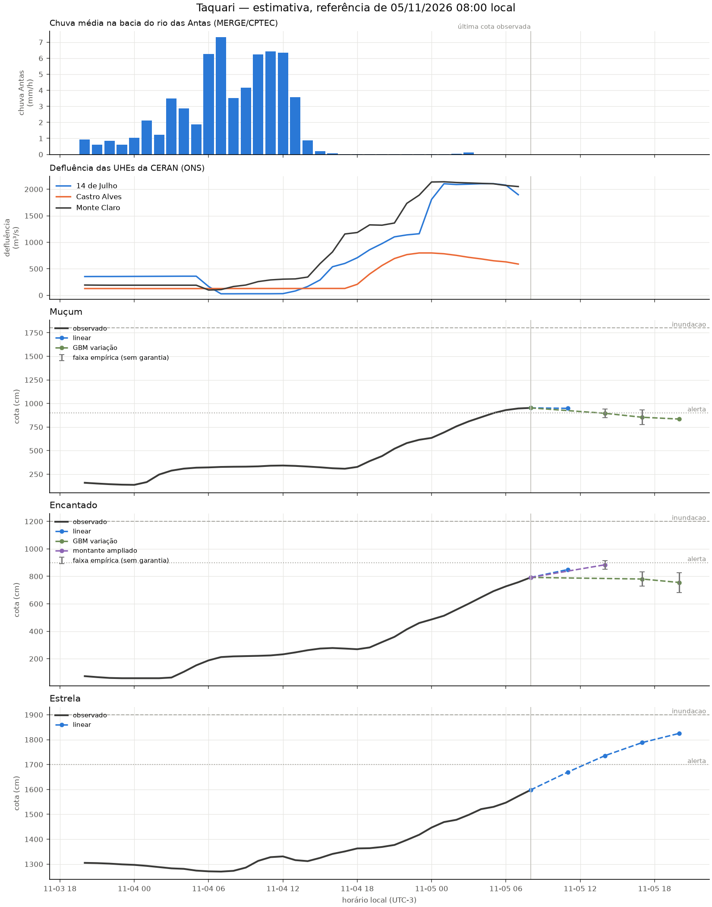

# Revisão da rodada de 05/11/2026 08:00

Modo: **emissao**. Referência observada: 05/11 08:00 (UTC−3). Emissão registrada em 05/11/2026 08:50:08 local. A antecedência real desconta o tempo desde a observação.

Horizontes contados desde a referência da própria estação; chuva e ONS mantêm seus atrasos no treino e na inferência. Alterações de modelo passam por comparação por fase da cheia. A coluna de cota é uma estimativa pontual, não uma cota de pico. Não é sistema de alerta.

| alvo      | motor          |   h | referencia_local   |   observado_cm |   previsto_cm | validade_local   |   antecedencia_real_h | status     |
|:----------|:---------------|----:|:-------------------|---------------:|--------------:|:-----------------|----------------------:|:-----------|
| Muçum     | linear         |   3 | 05/11 08:00        |            953 |         948.3 | 05/11 11:00      |                   2.2 | estimativa |
| Muçum     | gbm_delta      |   6 | 05/11 08:00        |            953 |         895.6 | 05/11 14:00      |                   5.2 | estimativa |
| Muçum     | gbm_delta      |   9 | 05/11 08:00        |            953 |         853.7 | 05/11 17:00      |                   8.2 | estimativa |
| Muçum     | gbm_delta      |  12 | 05/11 08:00        |            953 |         834.7 | 05/11 20:00      |                  11.2 | estimativa |
| Encantado | linear         |   3 | 05/11 08:00        |            792 |         849.4 | 05/11 11:00      |                   2.2 | estimativa |
| Encantado | ridge_montante |   6 | 05/11 08:00        |            792 |         884.1 | 05/11 14:00      |                   5.2 | estimativa |
| Encantado | gbm_delta      |   9 | 05/11 08:00        |            792 |         780.3 | 05/11 17:00      |                   8.2 | estimativa |
| Encantado | gbm_delta      |  12 | 05/11 08:00        |            792 |         755.1 | 05/11 20:00      |                  11.2 | estimativa |
| Estrela   | linear         |   3 | 05/11 08:00        |           1598 |        1669.8 | 05/11 11:00      |                   2.2 | estimativa |
| Estrela   | linear         |   6 | 05/11 08:00        |           1598 |        1735.8 | 05/11 14:00      |                   5.2 | estimativa |
| Estrela   | linear         |   9 | 05/11 08:00        |           1598 |        1788.2 | 05/11 17:00      |                   8.2 | estimativa |
| Estrela   | linear         |  12 | 05/11 08:00        |           1598 |        1825.3 | 05/11 20:00      |                  11.2 | estimativa |

## Faixas e diagnóstico

As faixas usam o quantil 90% dos erros de 2025, separado por regime, sem garantia de cobertura. Não são publicadas quando há menos de 30 pares, a velocidade está fora da calibração ou a cobertura dos últimos erros conhecidos cai abaixo de 80% (mínimo três pares nas últimas seis horas). Uma faixa ausente não significa erro zero.

| alvo      |   h | inferior_cm   | superior_cm   | faixa_status                   | cobertura_recente_pct   |   n_faixa_recente |
|:----------|----:|:--------------|:--------------|:-------------------------------|:------------------------|------------------:|
| Muçum     |   3 | —             | —             | sem calibração                 | —                       |                 0 |
| Muçum     |   6 | 849.7         | 941.6         | empírica, sem garantia         | 83.3                    |                 6 |
| Muçum     |   9 | 777.4         | 930.1         | empírica, sem garantia         | 100.0                   |                 6 |
| Muçum     |  12 | —             | —             | erros recentes excedem a faixa | 66.7                    |                 6 |
| Encantado |   3 | —             | —             | sem calibração                 | —                       |                 0 |
| Encantado |   6 | 852.5         | 915.7         | empírica, sem garantia         | 83.3                    |                 6 |
| Encantado |   9 | 727.8         | 832.8         | empírica, sem garantia         | 100.0                   |                 6 |
| Encantado |  12 | 682.4         | 827.9         | empírica, sem garantia         | 83.3                    |                 6 |
| Estrela   |   3 | —             | —             | sem calibração                 | —                       |                 0 |
| Estrela   |   6 | —             | —             | erros recentes excedem a faixa | 50.0                    |                 6 |
| Estrela   |   9 | —             | —             | erros recentes excedem a faixa | 50.0                    |                 6 |
| Estrela   |  12 | —             | —             | erros recentes excedem a faixa | 16.7                    |                 6 |

## Replay da subida

Referências a partir de 04/11 08:00; somente alvos já observados. Horizontes maiores têm menos pares. Ausência de linha significa ausência de pares, não erro zero.

| alvo      |   h |   MAE_cm |   vies_cm |   n |
|:----------|----:|---------:|----------:|----:|
| Encantado |   3 |     25.4 |     -18.1 |  22 |
| Encantado |   6 |     39.6 |     -37.1 |  19 |
| Encantado |   9 |     59.7 |     -56.6 |  16 |
| Encantado |  12 |    118.5 |    -118.5 |  13 |
| Estrela   |   3 |     21.7 |       0.3 |  22 |
| Estrela   |   6 |     30.1 |      -6.7 |  19 |
| Estrela   |   9 |     52.6 |     -34   |  16 |
| Estrela   |  12 |     86.2 |     -83.3 |  13 |
| Muçum     |   3 |     33.9 |     -24.7 |  22 |
| Muçum     |   6 |     58.1 |      -0.9 |  19 |
| Muçum     |   9 |     79.2 |     -66.1 |  16 |
| Muçum     |  12 |    145.1 |    -145.1 |  13 |

Os candidatos são escolhidos em 2023–2024, confirmados em 2025 e podem ser vetados por regressão em 2026. A comparação completa está em [melhoria e aceitação](12_melhoria_live.md). O replay assume atrasos fixos e não recompõe a publicação real de cada fonte.

Arquivo local da execução: `data/processed/live_runs/emissao_20261105T115008006258Z`. Contém previsões, replay, features, datasets de treino, código e configuração.

## Emissões reais conferidas

| alvo      |   h |   MAE_cm |   n |
|:----------|----:|---------:|----:|
| Encantado |   3 |     26.5 |  42 |
| Encantado |   6 |     81.7 |  42 |
| Encantado |   9 |    107.9 |  43 |
| Encantado |  12 |    129   |  43 |
| Estrela   |   3 |     15.4 |  43 |
| Estrela   |   6 |     35.6 |  43 |
| Estrela   |   9 |     68.8 |  43 |
| Estrela   |  12 |    108.3 |  43 |
| Muçum     |   3 |     33.7 |  10 |
| Muçum     |   6 |     89.6 |  43 |
| Muçum     |   9 |    132.1 |  43 |
| Muçum     |  12 |    171.1 |  43 |
