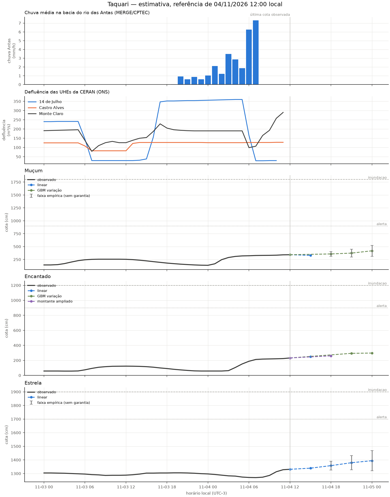

# Revisão da rodada de 04/11/2026 12:00

Modo: **emissao**. Referência observada: 04/11 12:00 (UTC−3). Emissão registrada em 04/11/2026 12:51:41 local. A antecedência real desconta o tempo desde a observação.

Horizontes contados desde a referência da própria estação; chuva e ONS mantêm seus atrasos no treino e na inferência. Alterações de modelo passam por comparação por fase da cheia. A coluna de cota é uma estimativa pontual, não uma cota de pico. Não é sistema de alerta.

| alvo      | motor          |   h | referencia_local   |   observado_cm |   previsto_cm | validade_local   |   antecedencia_real_h | status     |
|:----------|:---------------|----:|:-------------------|---------------:|--------------:|:-----------------|----------------------:|:-----------|
| Muçum     | linear         |   3 | 04/11 12:00        |            342 |         329.4 | 04/11 15:00      |                   2.1 | estimativa |
| Muçum     | gbm_delta      |   6 | 04/11 12:00        |            342 |         357.3 | 04/11 18:00      |                   5.1 | estimativa |
| Muçum     | gbm_delta      |   9 | 04/11 12:00        |            342 |         373.2 | 04/11 21:00      |                   8.1 | estimativa |
| Muçum     | gbm_delta      |  12 | 04/11 12:00        |            342 |         417.9 | 05/11 00:00      |                  11.1 | estimativa |
| Encantado | linear         |   3 | 04/11 12:00        |            232 |         249.3 | 04/11 15:00      |                   2.1 | estimativa |
| Encantado | ridge_montante |   6 | 04/11 12:00        |            232 |         260   | 04/11 18:00      |                   5.1 | estimativa |
| Encantado | gbm_delta      |   9 | 04/11 12:00        |            232 |         293.7 | 04/11 21:00      |                   8.1 | estimativa |
| Encantado | gbm_delta      |  12 | 04/11 12:00        |            232 |         297.3 | 05/11 00:00      |                  11.1 | estimativa |
| Estrela   | linear         |   3 | 04/11 12:00        |           1331 |        1339.3 | 04/11 15:00      |                   2.1 | estimativa |
| Estrela   | linear         |   6 | 04/11 12:00        |           1331 |        1357.9 | 04/11 18:00      |                   5.1 | estimativa |
| Estrela   | linear         |   9 | 04/11 12:00        |           1331 |        1379.4 | 04/11 21:00      |                   8.1 | estimativa |
| Estrela   | linear         |  12 | 04/11 12:00        |           1331 |        1394.2 | 05/11 00:00      |                  11.1 | estimativa |

## Faixas e diagnóstico

As faixas usam o quantil 90% dos erros de 2025, separado por regime, sem garantia de cobertura. Não são publicadas quando há menos de 30 pares, a velocidade está fora da calibração ou a cobertura dos últimos erros conhecidos cai abaixo de 80% (mínimo três pares nas últimas seis horas). Uma faixa ausente não significa erro zero.

| alvo      |   h | inferior_cm   | superior_cm   | faixa_status                   | cobertura_recente_pct   |   n_faixa_recente |
|:----------|----:|:--------------|:--------------|:-------------------------------|:------------------------|------------------:|
| Muçum     |   3 | —             | —             | sem calibração                 | —                       |                 0 |
| Muçum     |   6 | 311.3         | 403.3         | empírica, sem garantia         | 83.3                    |                 6 |
| Muçum     |   9 | 296.8         | 449.5         | empírica, sem garantia         | 83.3                    |                 6 |
| Muçum     |  12 | 311.3         | 524.4         | empírica, sem garantia         | 83.3                    |                 6 |
| Encantado |   3 | —             | —             | sem calibração                 | —                       |                 0 |
| Encantado |   6 | —             | —             | erros recentes excedem a faixa | 50.0                    |                 6 |
| Encantado |   9 | —             | —             | erros recentes excedem a faixa | 0.0                     |                 6 |
| Encantado |  12 | —             | —             | erros recentes excedem a faixa | 16.7                    |                 6 |
| Estrela   |   3 | —             | —             | sem calibração                 | —                       |                 0 |
| Estrela   |   6 | 1325.8        | 1390.0        | empírica, sem garantia         | 100.0                   |                 6 |
| Estrela   |   9 | 1327.8        | 1431.1        | empírica, sem garantia         | 83.3                    |                 6 |
| Estrela   |  12 | 1320.5        | 1467.8        | empírica, sem garantia         | 100.0                   |                 6 |

## Replay da subida

Referências a partir de 03/11 12:00; somente alvos já observados. Horizontes maiores têm menos pares. Ausência de linha significa ausência de pares, não erro zero.

| alvo      |   h |   MAE_cm |   vies_cm |   n |
|:----------|----:|---------:|----------:|----:|
| Encantado |   3 |     13.8 |      -3.7 |  22 |
| Encantado |   6 |     35   |      -8.6 |  19 |
| Encantado |   9 |     48.6 |     -33.9 |  16 |
| Encantado |  12 |     57   |     -47.2 |  13 |
| Estrela   |   3 |      8.1 |      -1   |  22 |
| Estrela   |   6 |      9.9 |       1.6 |  19 |
| Estrela   |   9 |     13.9 |      -9.6 |  16 |
| Estrela   |  12 |     16.9 |      -8.2 |  13 |
| Muçum     |   3 |     33.8 |       1.9 |  22 |
| Muçum     |   6 |     21.6 |      -4   |  19 |
| Muçum     |   9 |     36.3 |     -30   |  16 |
| Muçum     |  12 |     83.1 |     -74.8 |  13 |

Os candidatos são escolhidos em 2023–2024, confirmados em 2025 e podem ser vetados por regressão em 2026. A comparação completa está em [melhoria e aceitação](12_melhoria_live.md). O replay assume atrasos fixos e não recompõe a publicação real de cada fonte.

Arquivo local da execução: `data/processed/live_runs/emissao_20261104T155141989922Z`. Contém previsões, replay, features, datasets de treino, código e configuração.

## Emissões reais conferidas

| alvo      |   h |   MAE_cm |   n |
|:----------|----:|---------:|----:|
| Encantado |   3 |     28.2 |  37 |
| Encantado |   6 |     88.2 |  35 |
| Encantado |   9 |    112.8 |  36 |
| Encantado |  12 |    126.3 |  36 |
| Estrela   |   3 |     14.5 |  38 |
| Estrela   |   6 |     39.5 |  36 |
| Estrela   |   9 |     73.6 |  36 |
| Estrela   |  12 |    113.7 |  36 |
| Muçum     |   3 |     47.9 |   5 |
| Muçum     |   6 |     92.7 |  36 |
| Muçum     |   9 |    137.7 |  36 |
| Muçum     |  12 |    166.6 |  36 |
