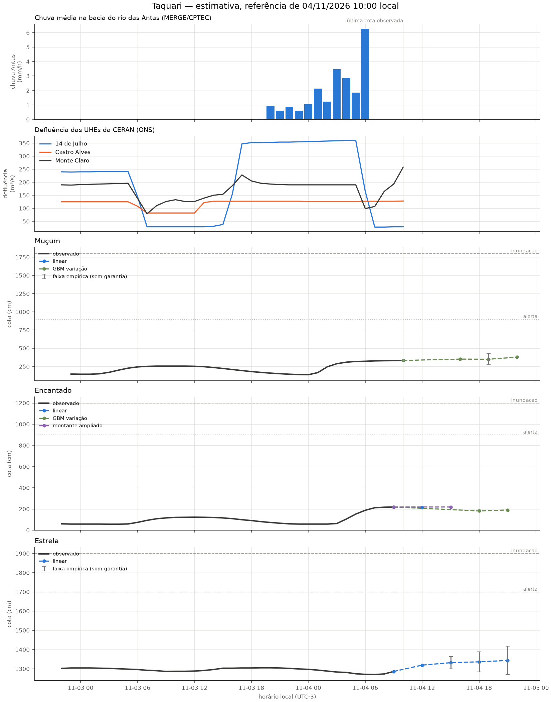

# Revisão da rodada de 04/11/2026 10:00

Modo: **emissao**. Referência observada: 04/11 10:00 (UTC−3). Emissão registrada em 04/11/2026 11:39:42 local. A antecedência real desconta o tempo desde a observação.

Horizontes contados desde a referência da própria estação; chuva e ONS mantêm seus atrasos no treino e na inferência. Alterações de modelo passam por comparação por fase da cheia. A coluna de cota é uma estimativa pontual, não uma cota de pico. Não é sistema de alerta.

| alvo      | motor          |   h | referencia_local   |   observado_cm | previsto_cm   | validade_local   |   antecedencia_real_h | status              |
|:----------|:---------------|----:|:-------------------|---------------:|:--------------|:-----------------|----------------------:|:--------------------|
| Muçum     | linear         |   3 | 04/11 10:00        |            333 | —             | 04/11 13:00      |                   1.3 | dados_insuficientes |
| Muçum     | gbm_delta      |   6 | 04/11 10:00        |            333 | 351.7         | 04/11 16:00      |                   4.3 | estimativa          |
| Muçum     | gbm_delta      |   9 | 04/11 10:00        |            333 | 349.6         | 04/11 19:00      |                   7.3 | estimativa          |
| Muçum     | gbm_delta      |  12 | 04/11 10:00        |            333 | 378.2         | 04/11 22:00      |                  10.3 | estimativa          |
| Encantado | linear         |   3 | 04/11 09:00        |            219 | 216.0         | 04/11 12:00      |                   0.3 | estimativa          |
| Encantado | ridge_montante |   6 | 04/11 09:00        |            219 | 218.9         | 04/11 15:00      |                   3.3 | estimativa          |
| Encantado | gbm_delta      |   9 | 04/11 09:00        |            219 | 181.8         | 04/11 18:00      |                   6.3 | estimativa          |
| Encantado | gbm_delta      |  12 | 04/11 09:00        |            219 | 190.6         | 04/11 21:00      |                   9.3 | estimativa          |
| Estrela   | linear         |   3 | 04/11 09:00        |           1286 | 1319.0        | 04/11 12:00      |                   0.3 | estimativa          |
| Estrela   | linear         |   6 | 04/11 09:00        |           1286 | 1331.7        | 04/11 15:00      |                   3.3 | estimativa          |
| Estrela   | linear         |   9 | 04/11 09:00        |           1286 | 1336.1        | 04/11 18:00      |                   6.3 | estimativa          |
| Estrela   | linear         |  12 | 04/11 09:00        |           1286 | 1343.3        | 04/11 21:00      |                   9.3 | estimativa          |

## Faixas e diagnóstico

As faixas usam o quantil 90% dos erros de 2025, separado por regime, sem garantia de cobertura. Não são publicadas quando há menos de 30 pares, a velocidade está fora da calibração ou a cobertura dos últimos erros conhecidos cai abaixo de 80% (mínimo três pares nas últimas seis horas). Uma faixa ausente não significa erro zero.

| alvo      |   h | inferior_cm   | superior_cm   | faixa_status                   | cobertura_recente_pct   |   n_faixa_recente |
|:----------|----:|:--------------|:--------------|:-------------------------------|:------------------------|------------------:|
| Muçum     |   3 | —             | —             | faltam dados                   | —                       |                 0 |
| Muçum     |   6 | —             | —             | erros recentes excedem a faixa | 66.7                    |                 6 |
| Muçum     |   9 | 273.2         | 425.9         | empírica, sem garantia         | 83.3                    |                 6 |
| Muçum     |  12 | —             | —             | erros recentes excedem a faixa | 66.7                    |                 6 |
| Encantado |   3 | —             | —             | sem calibração                 | —                       |                 0 |
| Encantado |   6 | —             | —             | erros recentes excedem a faixa | 16.7                    |                 6 |
| Encantado |   9 | —             | —             | erros recentes excedem a faixa | 50.0                    |                 6 |
| Encantado |  12 | —             | —             | erros recentes excedem a faixa | 66.7                    |                 6 |
| Estrela   |   3 | —             | —             | sem calibração                 | —                       |                 0 |
| Estrela   |   6 | 1299.6        | 1363.8        | empírica, sem garantia         | 100.0                   |                 6 |
| Estrela   |   9 | 1284.5        | 1387.7        | empírica, sem garantia         | 100.0                   |                 6 |
| Estrela   |  12 | 1269.6        | 1416.9        | empírica, sem garantia         | 100.0                   |                 6 |

## Replay da subida

Referências a partir de 03/11 10:00; somente alvos já observados. Horizontes maiores têm menos pares. Ausência de linha significa ausência de pares, não erro zero.

| alvo      |   h |   MAE_cm |   vies_cm |   n |
|:----------|----:|---------:|----------:|----:|
| Encantado |   3 |     12.2 |      -3.4 |  21 |
| Encantado |   6 |     34.6 |      -9.1 |  18 |
| Encantado |   9 |     30   |     -12.3 |  15 |
| Encantado |  12 |     41.5 |     -23.6 |  12 |
| Estrela   |   3 |      6.6 |       1.4 |  21 |
| Estrela   |   6 |      7.5 |      -2.4 |  18 |
| Estrela   |   9 |      6.5 |      -1.5 |  15 |
| Estrela   |  12 |      7.9 |       2.8 |  12 |
| Muçum     |   3 |     32.8 |       2.8 |  22 |
| Muçum     |   6 |     22   |      -4.2 |  19 |
| Muçum     |   9 |     33   |     -26.9 |  16 |
| Muçum     |  12 |     77.9 |     -53   |  13 |

Os candidatos são escolhidos em 2023–2024, confirmados em 2025 e podem ser vetados por regressão em 2026. A comparação completa está em [melhoria e aceitação](12_melhoria_live.md). O replay assume atrasos fixos e não recompõe a publicação real de cada fonte.

Arquivo local da execução: `data/processed/live_runs/emissao_20261104T143942065156Z`. Contém previsões, replay, features, datasets de treino, código e configuração.

## Emissões reais conferidas

| alvo      |   h |   MAE_cm |   n |
|:----------|----:|---------:|----:|
| Encantado |   3 |     28.9 |  35 |
| Encantado |   6 |     88.2 |  35 |
| Encantado |   9 |    112.8 |  36 |
| Encantado |  12 |    126.3 |  36 |
| Estrela   |   3 |     14.6 |  36 |
| Estrela   |   6 |     39.5 |  36 |
| Estrela   |   9 |     73.6 |  36 |
| Estrela   |  12 |    113.7 |  36 |
| Muçum     |   3 |     47.9 |   5 |
| Muçum     |   6 |     92.7 |  36 |
| Muçum     |   9 |    137.7 |  36 |
| Muçum     |  12 |    166.6 |  36 |
