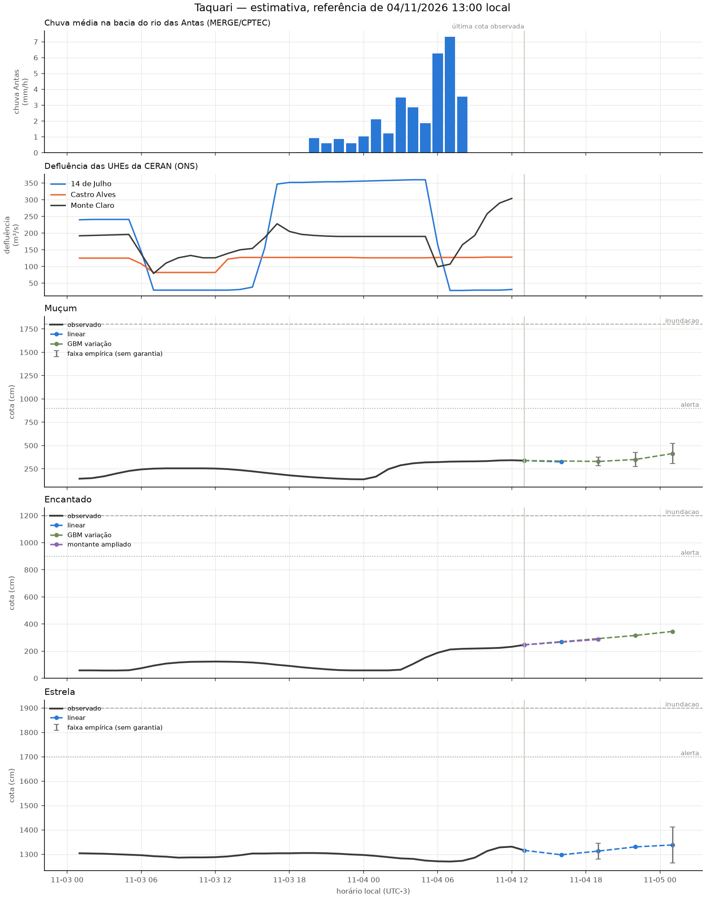

# Revisão da rodada de 04/11/2026 13:00

Modo: **emissao**. Referência observada: 04/11 13:00 (UTC−3). Emissão registrada em 04/11/2026 13:49:47 local. A antecedência real desconta o tempo desde a observação.

Horizontes contados desde a referência da própria estação; chuva e ONS mantêm seus atrasos no treino e na inferência. Alterações de modelo passam por comparação por fase da cheia. A coluna de cota é uma estimativa pontual, não uma cota de pico. Não é sistema de alerta.

| alvo      | motor          |   h | referencia_local   |   observado_cm |   previsto_cm | validade_local   |   antecedencia_real_h | status     |
|:----------|:---------------|----:|:-------------------|---------------:|--------------:|:-----------------|----------------------:|:-----------|
| Muçum     | linear         |   3 | 04/11 13:00        |            338 |         324.2 | 04/11 16:00      |                   2.2 | estimativa |
| Muçum     | gbm_delta      |   6 | 04/11 13:00        |            338 |         329.5 | 04/11 19:00      |                   5.2 | estimativa |
| Muçum     | gbm_delta      |   9 | 04/11 13:00        |            338 |         349.9 | 04/11 22:00      |                   8.2 | estimativa |
| Muçum     | gbm_delta      |  12 | 04/11 13:00        |            338 |         413.5 | 05/11 01:00      |                  11.2 | estimativa |
| Encantado | linear         |   3 | 04/11 13:00        |            246 |         269.6 | 04/11 16:00      |                   2.2 | estimativa |
| Encantado | ridge_montante |   6 | 04/11 13:00        |            246 |         286   | 04/11 19:00      |                   5.2 | estimativa |
| Encantado | gbm_delta      |   9 | 04/11 13:00        |            246 |         315.5 | 04/11 22:00      |                   8.2 | estimativa |
| Encantado | gbm_delta      |  12 | 04/11 13:00        |            246 |         345.2 | 05/11 01:00      |                  11.2 | estimativa |
| Estrela   | linear         |   3 | 04/11 13:00        |           1316 |        1297.7 | 04/11 16:00      |                   2.2 | estimativa |
| Estrela   | linear         |   6 | 04/11 13:00        |           1316 |        1312.9 | 04/11 19:00      |                   5.2 | estimativa |
| Estrela   | linear         |   9 | 04/11 13:00        |           1316 |        1330.2 | 04/11 22:00      |                   8.2 | estimativa |
| Estrela   | linear         |  12 | 04/11 13:00        |           1316 |        1337.9 | 05/11 01:00      |                  11.2 | estimativa |

## Faixas e diagnóstico

As faixas usam o quantil 90% dos erros de 2025, separado por regime, sem garantia de cobertura. Não são publicadas quando há menos de 30 pares, a velocidade está fora da calibração ou a cobertura dos últimos erros conhecidos cai abaixo de 80% (mínimo três pares nas últimas seis horas). Uma faixa ausente não significa erro zero.

| alvo      |   h | inferior_cm   | superior_cm   | faixa_status                   | cobertura_recente_pct   |   n_faixa_recente |
|:----------|----:|:--------------|:--------------|:-------------------------------|:------------------------|------------------:|
| Muçum     |   3 | —             | —             | sem calibração                 | —                       |                 0 |
| Muçum     |   6 | 283.5         | 375.4         | empírica, sem garantia         | 100.0                   |                 6 |
| Muçum     |   9 | 273.5         | 426.2         | empírica, sem garantia         | 83.3                    |                 6 |
| Muçum     |  12 | 307.0         | 520.1         | empírica, sem garantia         | 83.3                    |                 6 |
| Encantado |   3 | —             | —             | sem calibração                 | —                       |                 0 |
| Encantado |   6 | —             | —             | erros recentes excedem a faixa | 66.7                    |                 6 |
| Encantado |   9 | —             | —             | erros recentes excedem a faixa | 16.7                    |                 6 |
| Encantado |  12 | —             | —             | erros recentes excedem a faixa | 16.7                    |                 6 |
| Estrela   |   3 | —             | —             | sem calibração                 | —                       |                 0 |
| Estrela   |   6 | 1280.8        | 1345.0        | empírica, sem garantia         | 100.0                   |                 6 |
| Estrela   |   9 | —             | —             | erros recentes excedem a faixa | 66.7                    |                 6 |
| Estrela   |  12 | 1264.2        | 1411.5        | empírica, sem garantia         | 100.0                   |                 6 |

## Replay da subida

Referências a partir de 03/11 13:00; somente alvos já observados. Horizontes maiores têm menos pares. Ausência de linha significa ausência de pares, não erro zero.

| alvo      |   h |   MAE_cm |   vies_cm |   n |
|:----------|----:|---------:|----------:|----:|
| Encantado |   3 |     14.4 |      -4.9 |  22 |
| Encantado |   6 |     35.4 |      -6.9 |  19 |
| Encantado |   9 |     52.9 |     -40.4 |  16 |
| Encantado |  12 |     65.8 |     -59.9 |  13 |
| Estrela   |   3 |      9.6 |       1.6 |  22 |
| Estrela   |   6 |     10.6 |       3.3 |  19 |
| Estrela   |   9 |     18.3 |      -4.2 |  16 |
| Estrela   |  12 |     19.8 |     -11.3 |  13 |
| Muçum     |   3 |     35.5 |      -0   |  22 |
| Muçum     |   6 |     21.9 |      -3.3 |  19 |
| Muçum     |   9 |     36.7 |     -31.7 |  16 |
| Muçum     |  12 |     87.3 |     -85.9 |  13 |

Os candidatos são escolhidos em 2023–2024, confirmados em 2025 e podem ser vetados por regressão em 2026. A comparação completa está em [melhoria e aceitação](12_melhoria_live.md). O replay assume atrasos fixos e não recompõe a publicação real de cada fonte.

Arquivo local da execução: `data/processed/live_runs/emissao_20261104T164947112407Z`. Contém previsões, replay, features, datasets de treino, código e configuração.

## Emissões reais conferidas

| alvo      |   h |   MAE_cm |   n |
|:----------|----:|---------:|----:|
| Encantado |   3 |     28.2 |  37 |
| Encantado |   6 |     88.2 |  35 |
| Encantado |   9 |    112.8 |  36 |
| Encantado |  12 |    126.3 |  36 |
| Estrela   |   3 |     14.5 |  38 |
| Estrela   |   6 |     39.5 |  36 |
| Estrela   |   9 |     73.6 |  36 |
| Estrela   |  12 |    113.7 |  36 |
| Muçum     |   3 |     47.9 |   5 |
| Muçum     |   6 |     92.7 |  36 |
| Muçum     |   9 |    137.7 |  36 |
| Muçum     |  12 |    166.6 |  36 |
