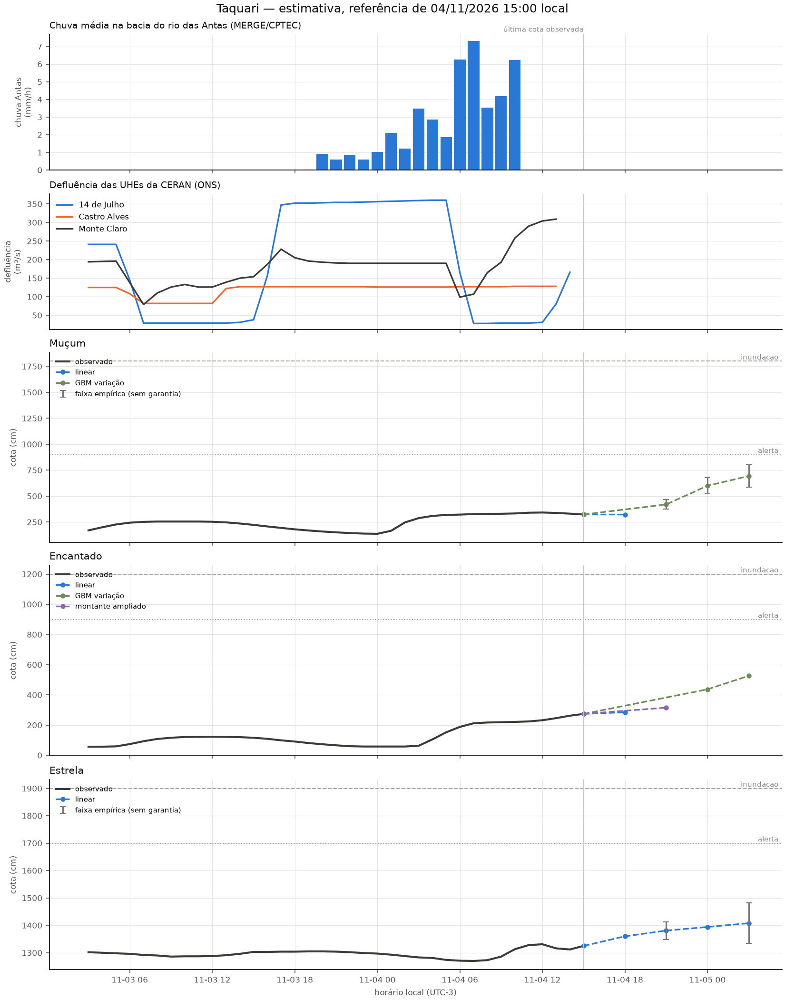

# Revisão da rodada de 04/11/2026 15:00

Modo: **emissao**. Referência observada: 04/11 15:00 (UTC−3). Emissão registrada em 04/11/2026 15:58:56 local. A antecedência real desconta o tempo desde a observação.

Horizontes contados desde a referência da própria estação; chuva e ONS mantêm seus atrasos no treino e na inferência. Alterações de modelo passam por comparação por fase da cheia. A coluna de cota é uma estimativa pontual, não uma cota de pico. Não é sistema de alerta.

| alvo      | motor          |   h | referencia_local   |   observado_cm |   previsto_cm | validade_local   |   antecedencia_real_h | status     |
|:----------|:---------------|----:|:-------------------|---------------:|--------------:|:-----------------|----------------------:|:-----------|
| Muçum     | linear         |   3 | 04/11 15:00        |            323 |         322.4 | 04/11 18:00      |                     2 | estimativa |
| Muçum     | gbm_delta      |   6 | 04/11 15:00        |            323 |         420   | 04/11 21:00      |                     5 | estimativa |
| Muçum     | gbm_delta      |   9 | 04/11 15:00        |            323 |         599.7 | 05/11 00:00      |                     8 | estimativa |
| Muçum     | gbm_delta      |  12 | 04/11 15:00        |            323 |         693.6 | 05/11 03:00      |                    11 | estimativa |
| Encantado | linear         |   3 | 04/11 15:00        |            274 |         284.7 | 04/11 18:00      |                     2 | estimativa |
| Encantado | ridge_montante |   6 | 04/11 15:00        |            274 |         315.4 | 04/11 21:00      |                     5 | estimativa |
| Encantado | gbm_delta      |   9 | 04/11 15:00        |            274 |         436.7 | 05/11 00:00      |                     8 | estimativa |
| Encantado | gbm_delta      |  12 | 04/11 15:00        |            274 |         526.1 | 05/11 03:00      |                    11 | estimativa |
| Estrela   | linear         |   3 | 04/11 15:00        |           1325 |        1360   | 04/11 18:00      |                     2 | estimativa |
| Estrela   | linear         |   6 | 04/11 15:00        |           1325 |        1381   | 04/11 21:00      |                     5 | estimativa |
| Estrela   | linear         |   9 | 04/11 15:00        |           1325 |        1394.1 | 05/11 00:00      |                     8 | estimativa |
| Estrela   | linear         |  12 | 04/11 15:00        |           1325 |        1407.8 | 05/11 03:00      |                    11 | estimativa |

## Faixas e diagnóstico

As faixas usam o quantil 90% dos erros de 2025, separado por regime, sem garantia de cobertura. Não são publicadas quando há menos de 30 pares, a velocidade está fora da calibração ou a cobertura dos últimos erros conhecidos cai abaixo de 80% (mínimo três pares nas últimas seis horas). Uma faixa ausente não significa erro zero.

| alvo      |   h | inferior_cm   | superior_cm   | faixa_status                   | cobertura_recente_pct   |   n_faixa_recente |
|:----------|----:|:--------------|:--------------|:-------------------------------|:------------------------|------------------:|
| Muçum     |   3 | —             | —             | sem calibração                 | —                       |                 0 |
| Muçum     |   6 | 374.1         | 466.0         | empírica, sem garantia         | 100.0                   |                 6 |
| Muçum     |   9 | 523.3         | 676.0         | empírica, sem garantia         | 83.3                    |                 6 |
| Muçum     |  12 | 587.1         | 800.2         | empírica, sem garantia         | 83.3                    |                 6 |
| Encantado |   3 | —             | —             | sem calibração                 | —                       |                 0 |
| Encantado |   6 | —             | —             | erros recentes excedem a faixa | 66.7                    |                 6 |
| Encantado |   9 | —             | —             | erros recentes excedem a faixa | 50.0                    |                 6 |
| Encantado |  12 | —             | —             | erros recentes excedem a faixa | 0.0                     |                 6 |
| Estrela   |   3 | —             | —             | sem calibração                 | —                       |                 0 |
| Estrela   |   6 | 1348.8        | 1413.1        | empírica, sem garantia         | 100.0                   |                 6 |
| Estrela   |   9 | —             | —             | erros recentes excedem a faixa | 33.3                    |                 6 |
| Estrela   |  12 | 1334.2        | 1481.5        | empírica, sem garantia         | 100.0                   |                 6 |

## Replay da subida

Referências a partir de 03/11 15:00; somente alvos já observados. Horizontes maiores têm menos pares. Ausência de linha significa ausência de pares, não erro zero.

| alvo      |   h |   MAE_cm |   vies_cm |   n |
|:----------|----:|---------:|----------:|----:|
| Encantado |   3 |     16.1 |      -7.9 |  22 |
| Encantado |   6 |     40.9 |     -12.4 |  19 |
| Encantado |   9 |     56.5 |     -47.3 |  16 |
| Encantado |  12 |     88.5 |     -86.5 |  13 |
| Estrela   |   3 |     11.9 |       4.5 |  22 |
| Estrela   |   6 |     10.7 |       4.4 |  19 |
| Estrela   |   9 |     27.2 |       5.3 |  16 |
| Estrela   |  12 |     24.4 |     -19.8 |  13 |
| Muçum     |   3 |     35.2 |      -1.2 |  22 |
| Muçum     |   6 |     22.8 |      -4.1 |  19 |
| Muçum     |   9 |     39.3 |     -29.1 |  16 |
| Muçum     |  12 |     80.8 |     -80.8 |  13 |

Os candidatos são escolhidos em 2023–2024, confirmados em 2025 e podem ser vetados por regressão em 2026. A comparação completa está em [melhoria e aceitação](12_melhoria_live.md). O replay assume atrasos fixos e não recompõe a publicação real de cada fonte.

Arquivo local da execução: `data/processed/live_runs/emissao_20261104T185856333007Z`. Contém previsões, replay, features, datasets de treino, código e configuração.

## Emissões reais conferidas

| alvo      |   h |   MAE_cm |   n |
|:----------|----:|---------:|----:|
| Encantado |   3 |     28.1 |  38 |
| Encantado |   6 |     86.4 |  37 |
| Encantado |   9 |    112.8 |  36 |
| Encantado |  12 |    126.3 |  36 |
| Estrela   |   3 |     14.5 |  39 |
| Estrela   |   6 |     37.8 |  38 |
| Estrela   |   9 |     73.6 |  36 |
| Estrela   |  12 |    113.7 |  36 |
| Muçum     |   3 |     41   |   6 |
| Muçum     |   6 |     92.7 |  36 |
| Muçum     |   9 |    137.7 |  36 |
| Muçum     |  12 |    166.6 |  36 |
