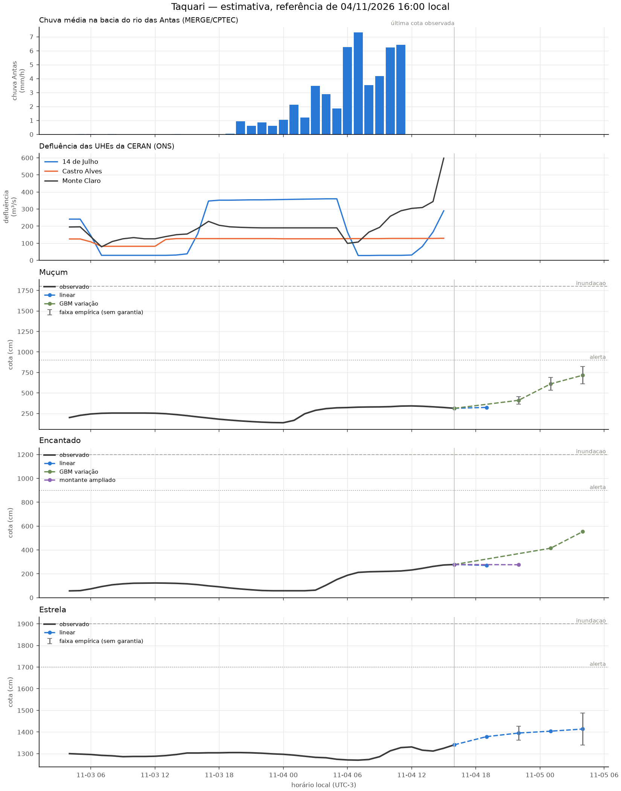

# Revisão da rodada de 04/11/2026 16:00

Modo: **emissao**. Referência observada: 04/11 16:00 (UTC−3). Emissão registrada em 04/11/2026 16:50:12 local. A antecedência real desconta o tempo desde a observação.

Horizontes contados desde a referência da própria estação; chuva e ONS mantêm seus atrasos no treino e na inferência. Alterações de modelo passam por comparação por fase da cheia. A coluna de cota é uma estimativa pontual, não uma cota de pico. Não é sistema de alerta.

| alvo      | motor          |   h | referencia_local   |   observado_cm |   previsto_cm | validade_local   |   antecedencia_real_h | status     |
|:----------|:---------------|----:|:-------------------|---------------:|--------------:|:-----------------|----------------------:|:-----------|
| Muçum     | linear         |   3 | 04/11 16:00        |            313 |         324   | 04/11 19:00      |                   2.2 | estimativa |
| Muçum     | gbm_delta      |   6 | 04/11 16:00        |            313 |         410.6 | 04/11 22:00      |                   5.2 | estimativa |
| Muçum     | gbm_delta      |   9 | 04/11 16:00        |            313 |         611.1 | 05/11 01:00      |                   8.2 | estimativa |
| Muçum     | gbm_delta      |  12 | 04/11 16:00        |            313 |         716.5 | 05/11 04:00      |                  11.2 | estimativa |
| Encantado | linear         |   3 | 04/11 16:00        |            278 |         270.6 | 04/11 19:00      |                   2.2 | estimativa |
| Encantado | ridge_montante |   6 | 04/11 16:00        |            278 |         276.1 | 04/11 22:00      |                   5.2 | estimativa |
| Encantado | gbm_delta      |   9 | 04/11 16:00        |            278 |         414.6 | 05/11 01:00      |                   8.2 | estimativa |
| Encantado | gbm_delta      |  12 | 04/11 16:00        |            278 |         554   | 05/11 04:00      |                  11.2 | estimativa |
| Estrela   | linear         |   3 | 04/11 16:00        |           1341 |        1378.7 | 04/11 19:00      |                   2.2 | estimativa |
| Estrela   | linear         |   6 | 04/11 16:00        |           1341 |        1395.3 | 04/11 22:00      |                   5.2 | estimativa |
| Estrela   | linear         |   9 | 04/11 16:00        |           1341 |        1403.9 | 05/11 01:00      |                   8.2 | estimativa |
| Estrela   | linear         |  12 | 04/11 16:00        |           1341 |        1413.8 | 05/11 04:00      |                  11.2 | estimativa |

## Faixas e diagnóstico

As faixas usam o quantil 90% dos erros de 2025, separado por regime, sem garantia de cobertura. Não são publicadas quando há menos de 30 pares, a velocidade está fora da calibração ou a cobertura dos últimos erros conhecidos cai abaixo de 80% (mínimo três pares nas últimas seis horas). Uma faixa ausente não significa erro zero.

| alvo      |   h | inferior_cm   | superior_cm   | faixa_status                   | cobertura_recente_pct   |   n_faixa_recente |
|:----------|----:|:--------------|:--------------|:-------------------------------|:------------------------|------------------:|
| Muçum     |   3 | —             | —             | sem calibração                 | —                       |                 0 |
| Muçum     |   6 | 364.7         | 456.6         | empírica, sem garantia         | 100.0                   |                 6 |
| Muçum     |   9 | 534.7         | 687.5         | empírica, sem garantia         | 100.0                   |                 6 |
| Muçum     |  12 | 609.9         | 823.0         | empírica, sem garantia         | 83.3                    |                 6 |
| Encantado |   3 | —             | —             | sem calibração                 | —                       |                 0 |
| Encantado |   6 | —             | —             | erros recentes excedem a faixa | 50.0                    |                 6 |
| Encantado |   9 | —             | —             | erros recentes excedem a faixa | 66.7                    |                 6 |
| Encantado |  12 | —             | —             | erros recentes excedem a faixa | 16.7                    |                 6 |
| Estrela   |   3 | —             | —             | sem calibração                 | —                       |                 0 |
| Estrela   |   6 | 1363.1        | 1427.4        | empírica, sem garantia         | 83.3                    |                 6 |
| Estrela   |   9 | —             | —             | erros recentes excedem a faixa | 33.3                    |                 6 |
| Estrela   |  12 | 1340.1        | 1487.4        | empírica, sem garantia         | 83.3                    |                 6 |

## Replay da subida

Referências a partir de 03/11 16:00; somente alvos já observados. Horizontes maiores têm menos pares. Ausência de linha significa ausência de pares, não erro zero.

| alvo      |   h |   MAE_cm |   vies_cm |   n |
|:----------|----:|---------:|----------:|----:|
| Encantado |   3 |     16.1 |      -8.6 |  22 |
| Encantado |   6 |     43.1 |     -15.2 |  19 |
| Encantado |   9 |     56.5 |     -48.9 |  16 |
| Encantado |  12 |     94.4 |     -94.4 |  13 |
| Estrela   |   3 |     13.5 |       2.2 |  22 |
| Estrela   |   6 |     12.3 |       6   |  19 |
| Estrela   |   9 |     27.3 |       5.5 |  16 |
| Estrela   |  12 |     29.5 |     -14.7 |  13 |
| Muçum     |   3 |     35.1 |      -1.2 |  22 |
| Muçum     |   6 |     22.6 |      -4.2 |  19 |
| Muçum     |   9 |     41.1 |     -27.2 |  16 |
| Muçum     |  12 |     73.3 |     -68.5 |  13 |

Os candidatos são escolhidos em 2023–2024, confirmados em 2025 e podem ser vetados por regressão em 2026. A comparação completa está em [melhoria e aceitação](12_melhoria_live.md). O replay assume atrasos fixos e não recompõe a publicação real de cada fonte.

Arquivo local da execução: `data/processed/live_runs/emissao_20261104T195012791207Z`. Contém previsões, replay, features, datasets de treino, código e configuração.

## Emissões reais conferidas

| alvo      |   h |   MAE_cm |   n |
|:----------|----:|---------:|----:|
| Encantado |   3 |     27.6 |  39 |
| Encantado |   6 |     86.4 |  37 |
| Encantado |   9 |    112.8 |  36 |
| Encantado |  12 |    126.3 |  36 |
| Estrela   |   3 |     15.2 |  40 |
| Estrela   |   6 |     37.8 |  38 |
| Estrela   |   9 |     73.6 |  36 |
| Estrela   |  12 |    113.7 |  36 |
| Muçum     |   3 |     36.7 |   7 |
| Muçum     |   6 |     89.9 |  38 |
| Muçum     |   9 |    137.7 |  36 |
| Muçum     |  12 |    166.6 |  36 |
